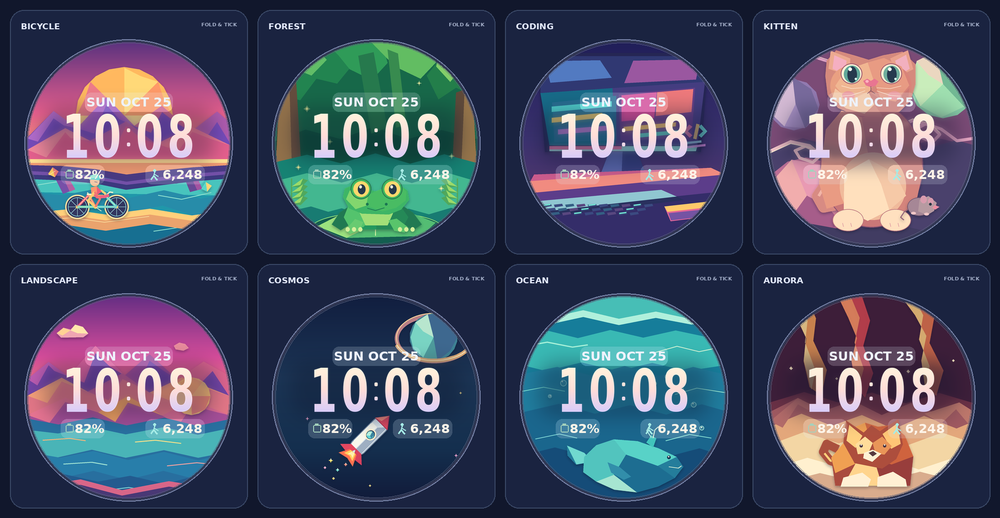
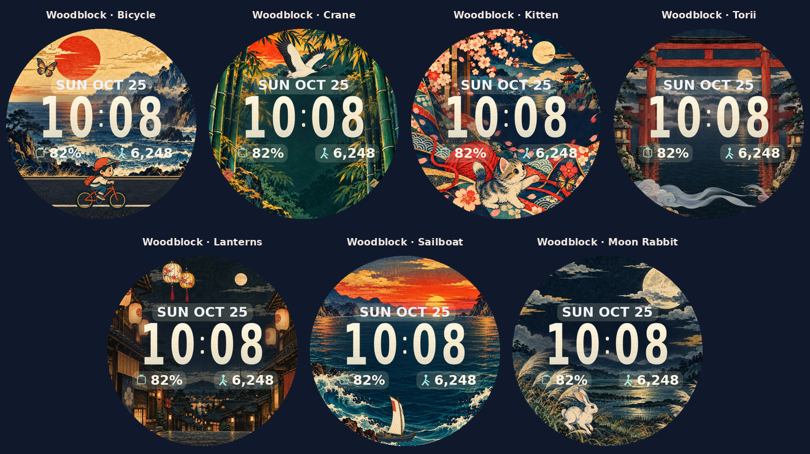
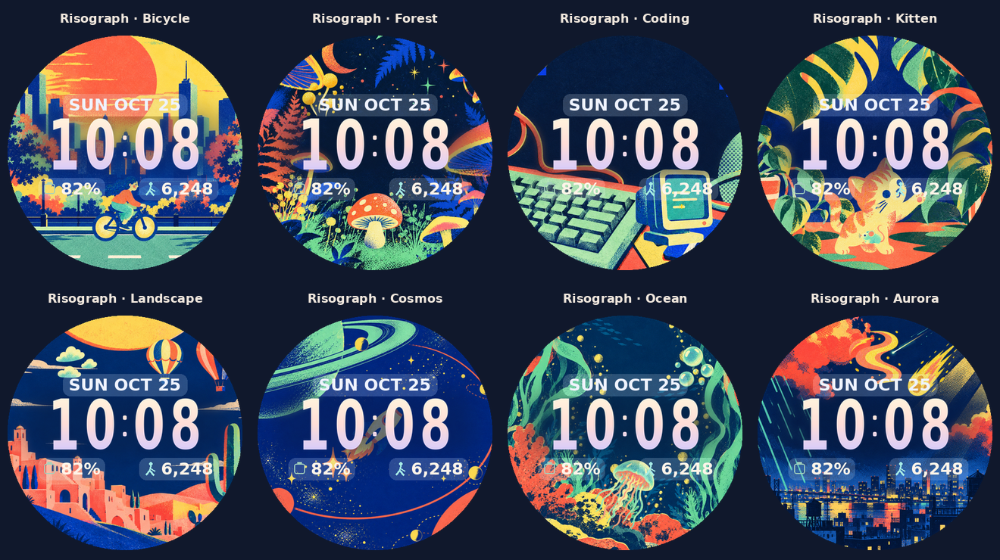
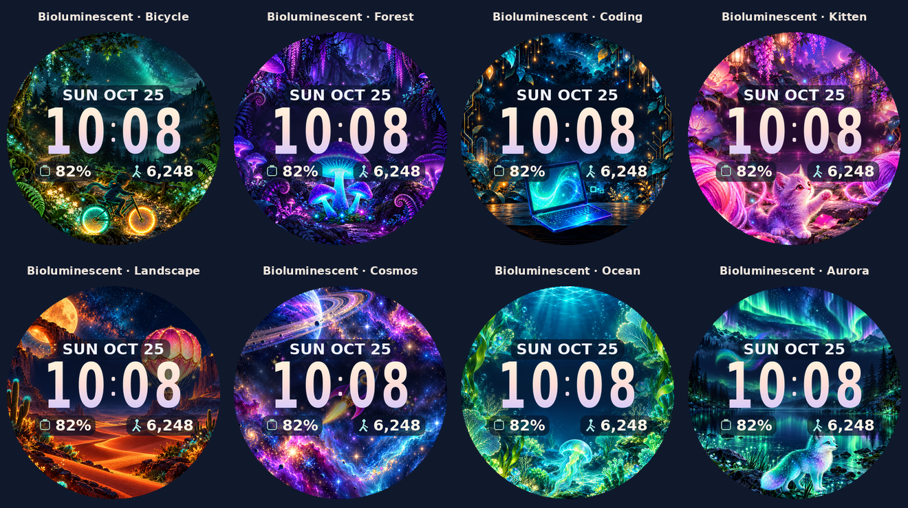
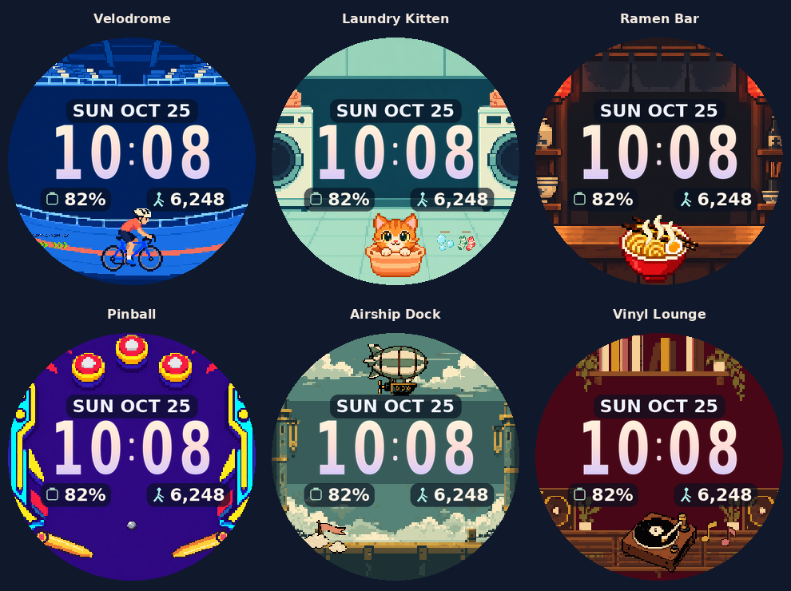
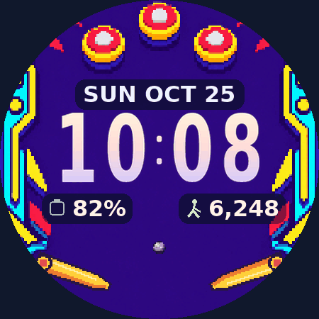
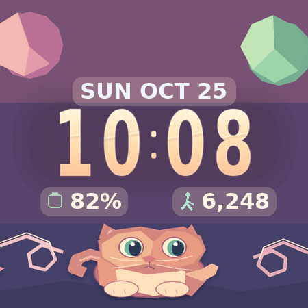

# Fold & Tick

[](https://github.com/sgerner/fold-and-tick/actions/workflows/ci.yml)
[](https://github.com/sgerner/fold-and-tick/releases/latest)
[](LICENSE)

**Tiny art worlds. Big, readable time.** An animated watch face with five art styles for **Pixel Watch 3 (41 mm and 45 mm)** and other **Wear OS 5+** watches.

[**Download the latest APK**](https://github.com/sgerner/fold-and-tick/releases/latest/download/Fold-and-Tick.apk) · [**Try the live preview**](https://sgerner.github.io/fold-and-tick/) · [**Install on your watch**](#install-on-your-watch)



## A little world for every mood

Choose **Art style** first, then select a scene and rotation interval. Woodblock has seven designs; Origami, Risograph, and Bioluminescent each have eight. Pixel art has six original scenes: Velodrome, Laundry Kitten, Ramen Bar, Pinball, Airship Dock, and Vinyl Lounge. Every style includes bicycle and kitten themes. Automatic rotation stays within your chosen style; it never switches packs. Origami remains the default, preserving existing settings.

Origami has a warm folded-paper clock, matching cream glass, and compositions that leave room for the time and complications.

In the watch face editor, the **Origami: Bicycle**, **Woodblock: Crane**, and other style-labeled switches choose which Origami or Woodblock scenes participate in automatic rotation. Woodblock and Pixel art have their own scene selectors and thumbnails. Origami, Risograph, and Bioluminescent share a selector with Origami thumbnails in the watch editor; the browser preview shows each style’s own thumbnails. Risograph, Bioluminescent, and Pixel art rotate through all their scenes on the selected schedule. Woodblock’s Sailboat and Moon Rabbit favorites share one selector with Both, Sailboat, Moon Rabbit, and Neither choices. A fixed scene always respects your selection.

| Art style | Character | Scenes |
| --- | --- | --- |
| Origami | Bright folded paper and faceted shapes | [Original pack](preview/contact-sheet.png) |
| Woodblock | Carved ink lines, washi grain, indigo, vermilion, and a parchment clock | [Woodblock pack](preview/styles/woodblock.png) |
| Risograph | Bright spot colors, grainy ink, print overlap | [Risograph pack](preview/styles/risograph.png) |
| Bioluminescent | Luminous creatures and colorful light in the dark | [Bioluminescent pack](preview/styles/bioluminescent.png) |
| Pixel art | Clean, simplified 8-bit illustrations with crisp silhouettes and arcade-inspired scenes | [Pixel art pack](preview/styles/pixel_art.png) |

| **Woodblock · 7 scenes** | **Risograph · 8 scenes** |
| --- | --- |
|  |  |

[View Woodblock and Risograph together](preview/styles/all-packs.png)






Pinball uses a shared ten-second physics-based animation: hinged flippers launch the ball into gravity-driven arcs and rebounds off rails and bumpers, with brief collision flashes. The watch and preview use the same trajectory; motion-off freezes the scene and ambient mode hides it. 

[See Bioluminescent and Pixel art in motion](preview/styles/new-packs-motion.gif) · Render the proof with `tools/.venv/bin/python tools/render_new_pack_motion.py`.

Every style uses independent character and detail layers, with scenes tailored to its visual language. In Woodblock, a cyclist travels a road, a crane flies among bamboo, a kitten plays with a butterfly, mist drifts around a torii gate, festival lanterns sway, a sailboat rides the waves, and a rabbit watches the moon. Origami's kitten and mouse move independently, and its rocket flies diagonally with sparks. Risograph has graphic scenes including a city ride, mushroom forest, retro terminal, houseplant kitten, desert city, orbital transit, jellyfish aquarium, and neon weather. All motion can be paused, and always-on mode hides the full-color scenes.

[Compare Woodblock and Risograph in motion](preview/styles/motion.gif) · Render the same proof with `tools/.venv/bin/python tools/render_style_motion.py`.

The original Origami pack includes:

| Scene | What moves |
| --- | --- |
| Bicycle | A cyclist rides all the way across a sunrise valley. |
| Forest | A paper frog hops on its lily pad among green leaves and glowing fireflies. |
| Coding | A paper laptop below the clock has a blinking cursor, colorful code, and moving desk details. |
| Kitten | A bright-eyed kitten pounces in a yarn world while a mouse runs along its own path. |
| Landscape | A faceted mountain lake with drifting clouds and sunset light. |
| Cosmos | A capsule rocket climbs past a ringed planet, trailing flickering sparks. |
| Ocean | A folded whale swims across the lower sea through layered blue water and bubbles. |
| Aurora | Amber, yellow, orange, and red light curtains sway above a sleeping paper fox. |

- Oversized ombré time follows your device's 12/24-hour preference, without AM/PM clutter.
- Three configurable complication slots with larger text: a wide date/long-text row and two compact icon-and-value readouts.
- Borderless glass sizes to the date and complication values. Icon/value pairs stay centered with a small gap.
- The default date uses a short uppercase weekday and month, such as **SUN OCT 25**, without a comma. Custom providers supply their own text.
- Rotate scenes every **15 minutes, 30 minutes, 1 hour, 3 hours, 6 hours, or daily**, or keep one selected.
- Pause motion when you want a still composition. Origami and Woodblock softly fade between scheduled scenes while motion is enabled.
- Always-on mode hides the scenes and glass, leaving time and complications on black. Origami and Woodblock keep sparse, dim motifs at the edge.
- The installed face works offline, with no companion app or account.

### Kitten in motion



[Watch the rocket flight](preview/rocket-motion.gif) · [Watch the bicycle pass](preview/scene-motion.gif) · [Watch the whale swim](preview/ocean-motion.gif)

## Install on your watch

You need a **Wear OS 5+ watch**, a computer with [Android platform tools](https://developer.android.com/tools/releases/platform-tools), and both devices on the same Wi-Fi network. This is a watch-face package: install it **on the watch**, not your phone.

1. [Download `Fold-and-Tick.apk`](https://github.com/sgerner/fold-and-tick/releases/latest/download/Fold-and-Tick.apk).
2. On the watch, open **Settings → System → About → Versions** and tap **Build number** seven times. Menu wording varies slightly by watch/software version.
3. Open **Developer options**, enable **ADB debugging** and **Wireless debugging**, then choose **Pair new device**.
4. Pair using the pairing address/port and the code shown on the watch:

   ```sh
   adb pair WATCH_IP:PAIRING_PORT
   ```

5. Return to the main Wireless debugging screen. Connect using its debugging address/port, which is usually **different from the pairing port**:

   ```sh
   adb connect WATCH_IP:DEBUG_PORT
   adb devices
   adb install -r Fold-and-Tick.apk
   ```

   With multiple devices connected, target the watch explicitly:

   ```sh
   adb -s WATCH_IP:DEBUG_PORT install -r Fold-and-Tick.apk
   ```

6. Long-press the current face, choose **Add new**, find **Fold & Tick**, and select it. Open its editor to choose **Art style**, scene, rotation, motion, and complication providers.
7. You can turn wireless debugging off after installation.

There is no launcher icon to tap. The face is selected through the watch-face picker. The preview website uses sample complication data; its controls do not configure the watch.

### Updates and common issues

Public releases use a persistent signing key, so `adb install -r` updates them while retaining your face settings. If you installed an earlier **local debug build**, its signing key differs. To switch to public releases, uninstall that build once, then install the downloaded APK. Uninstalling resets this face's customization:

```sh
adb uninstall com.foldandtick.watchface
adb install Fold-and-Tick.apk
```

- **`INSTALL_FAILED_UPDATE_INCOMPATIBLE`**: the installed build has a different signing certificate; see the debug-build note above.
- **Watch not listed by `adb devices`**: reconnect using the debugging port, not the pairing port, and accept any watch-side prompt.
- **Face missing from the picker after sideloading**: long-press the current face and open **Add new**. If it still does not appear, [Google documents a direct selection command](https://developer.android.com/codelabs/watch-face-format) that selects the installed face and adds it to favorites:

  ```sh
  adb -s WATCH_IP:DEBUG_PORT shell am broadcast \
    -a com.google.android.wearable.app.DEBUG_SURFACE \
    --es operation set-watchface \
    --es watchFaceId com.foldandtick.watchface
  ```

- **Missing complication value**: pick an available provider in the face editor. Unavailable text displays an em dash.
- **APK verification**: each release includes `SHA256SUMS` and the public signing-certificate fingerprint.

## Build and contribute

This is a resource-only **Watch Face Format 2** package. Wear OS renders the XML and images; the APK contains no application bytecode. Origami artwork uses deterministic polygon geometry. Woodblock, Risograph, and Bioluminescent use saved artwork and transparent actor layers; Pixel art uses original generated environments and transparent animated sprites. Source artwork and prompts are kept under [`artwork/packs`](artwork/packs).

Requirements: **Java 21**, **Android SDK platform 36/build tools 36.0.0**, and Python 3. The Gradle wrapper is included. Point `ANDROID_HOME` at your SDK, or create an ignored `local.properties` with `sdk.dir=/path/to/Android/Sdk`.

```sh
./gradlew :watchface:assembleDebug
# watchface/build/outputs/apk/debug/watchface-debug.apk

tools/validate.sh
```

Validation checks WFF syntax, rotation/calendar boundaries, independent subject motion, thumbnail limits, Pages asset paths, Android build/lint, zero DEX files, named resource retention, and active/ambient memory budgets. Google's validator downloads are checksum-pinned in `tools/validate.sh`.

### Rebuild the artwork

```sh
uv venv --python 3.13 tools/.venv
uv pip install --python tools/.venv/bin/python -r tools/requirements.txt
tools/.venv/bin/python tools/generate_clock.py
tools/.venv/bin/python tools/generate_art.py
tools/.venv/bin/python tools/import_style_packs.py
tools/.venv/bin/python tools/import_bioluminescent.py
tools/.venv/bin/python tools/import_pixel_art.py
python3 tools/pinball_motion.py
python3 tools/embed_pinball_watchface.py
python3 tools/build_preview.py --output preview
python3 -m http.server 8080
# http://localhost:8080/preview/
```

`import_style_packs.py` deterministically resizes saved artwork, extracts actors from sprite sheets or individual transparent files, and builds background, actor, detail, glass, and thumbnail resources plus labeled pack proofs. It does not call an image service; ordinary builds work offline. The image-based packs retain their sources and generation prompts. The Bioluminescent and Pixel art importers also rebuild their resources offline from saved environments and sprite atlases. Pixel art source illustrations and generation prompts are in `artwork/packs/pixel_art/clean_sources`; placement metadata is in its scene catalog. The importer uses nearest-neighbor sampling without averaging or automatic palette remapping.

`generate_clock.py --font /path/to/DejaVuSans-Bold.ttf` supports other font locations. Building a standalone preview for any static host is just:

```sh
python3 tools/build_preview.py --output site
```

The output has relative asset paths and works under GitHub Pages' `/fold-and-tick/` project path. The demo matches the native clock scale, short date format, and complication glass gradients and geometry. Both use capped character-width estimates to size complication backgrounds because WFF 2 does not expose measured text width. System fonts, provider icons, and provider text can vary between devices. The broad time backing uses the same preblurred scene texture in the watch face and demo; complication glass is a translucent gradient, without a live blur filter.

### Releases and automation

- **CI** builds the debug APK, runs all checks, and uploads APK/report artifacts on pushes and pull requests.
- **Release** repeats validation, builds a signed APK, verifies its contents/signature/memory, publishes the stable `Fold-and-Tick.apk` asset and checksums when a matching `v*` tag is pushed.
- **Pages** deploys the preview from `main`. Its download link uses GitHub's `releases/latest/download/` route, so it automatically follows each new public release.
- **Dependabot** groups weekly GitHub Actions, Gradle, and Python dependency updates.
- **CodeQL** scans Python/JavaScript; pull requests also receive dependency review. Actions are pinned to immutable commits.

Maintainer signing secrets are `FOLD_TICK_KEYSTORE_BASE64`, `FOLD_TICK_STORE_PASSWORD`, `FOLD_TICK_KEY_ALIAS`, and `FOLD_TICK_KEY_PASSWORD`. Private keys are **not committed**. Forks should create their own keystore and secrets before publishing releases.

To cut a release, update Android `versionName`/`versionCode`, regenerate changed artwork, validate, commit, then push the matching tag (for example, `v1.4.0`). The workflow rejects mismatched tags and refuses to overwrite an existing release. Signing builds disable Gradle's configuration cache to avoid caching signing passwords.

## License and testing

Original code and scene artwork use **[0BSD](LICENSE)**: use, modify, and redistribute them for any purpose, with or without a fee. See [NOTICE.md](NOTICE.md) for the DejaVu glyph and Gradle wrapper notices.

The original Origami face has been exercised in a round Wear OS 5 emulator and on a physical Pixel Watch 3, including date formatting, provider icons, complication spacing, adaptive glass, visible motion, and always-on mode. The Origami review update has also been installed and its larger text and warm glass checked in a physical Pixel Watch 3 screenshot; automated checks cover all 256 favorite subsets and eight selected scenes. The additional art packs have been reviewed in the browser and labeled proofs. They have not yet been visually checked on a physical watch. The browser demo uses sample battery/step data; it does not read or configure your watch.
